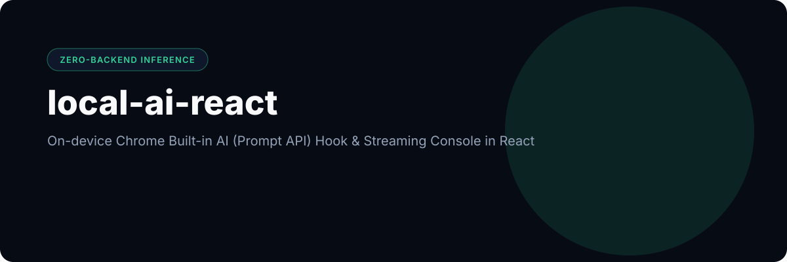
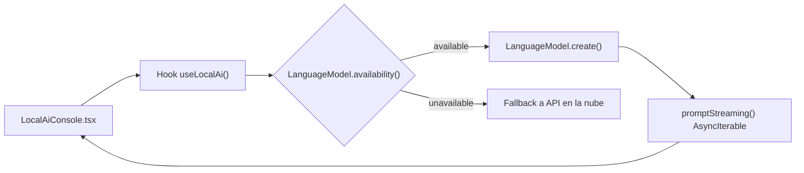

<p align="right">
  <a href="./README.md">🇺🇸 Read in English</a>
</p>

<p align="center">
  
</p>

<p align="center">
  
  
  
  
</p>

# local-ai-react

Hook en React + TypeScript (`useLocalAi`) y consola con streaming para ejecutar **inferencia de IA local directamente en el navegador** mediante la **Prompt API integrada de Chrome (`LanguageModel`)**, sin servidores backend, sin costo por tokens y con privacidad total offline.

---

## Arquitectura



---

## Inicio rápido

```bash
git clone https://github.com/stephanocamoretti-dotcom/local-ai-react.git
cd local-ai-react
npm install
npm run dev
```

---

## Referencias

- [Chrome for Developers — Prompt API (Built-in AI)](https://developer.chrome.com/docs/ai/prompt-api)
- [W3C WebML Community Group — Prompt API Explainer](https://github.com/webmachinelearning/prompt-api)
