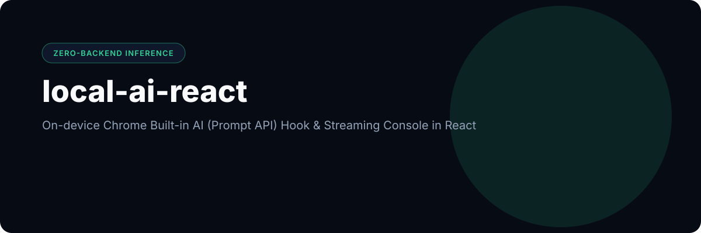
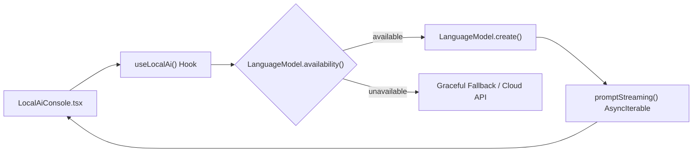

<p align="right">
  <a href="./README.es.md">🇪🇸 Leer en Español</a>
</p>

<p align="center">
  
</p>

<p align="center">
  
  
  
  
</p>

# local-ai-react

A lightweight React + TypeScript hook (`useLocalAi`) and streaming console for running **on-device AI inference directly inside the browser** using the **Chrome Built-in AI Prompt API (`LanguageModel`)**—with zero backend servers, zero API token costs, and full offline privacy.

---

## Architecture



---

## Quick Start

```bash
git clone https://github.com/stephanocamoretti-dotcom/local-ai-react.git
cd local-ai-react
npm install
npm run dev
```

---

## References

- [Chrome for Developers — Prompt API (Built-in AI)](https://developer.chrome.com/docs/ai/prompt-api)
- [W3C WebML Community Group — Prompt API Explainer](https://github.com/webmachinelearning/prompt-api)
